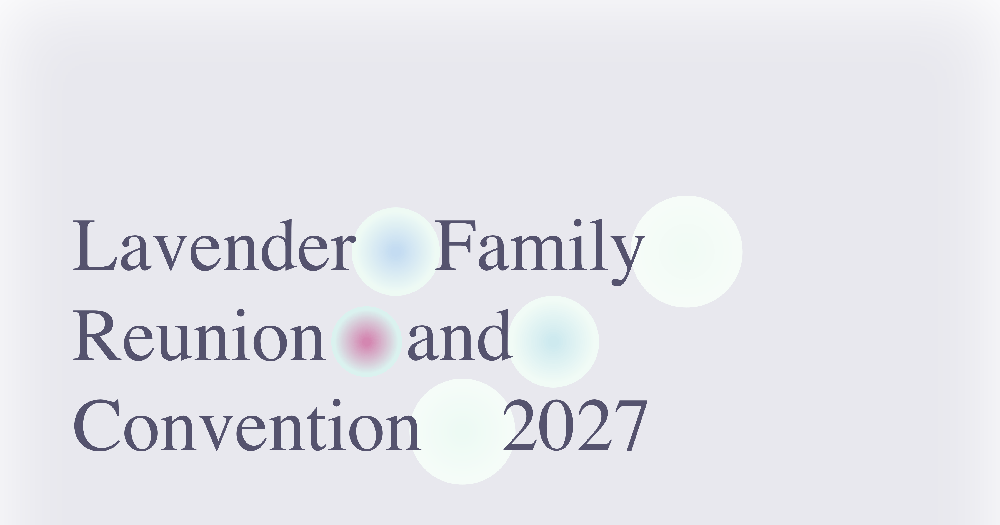

A website for 2027’s queer Sacred Harp gathering, to be held in Chicago. Currently in placeholder mode.

I figured this site could be a little more adventurous than [Midwest 41](https://2026.midwestsacredharp.org/) based on the purpose and audience and year-long rollout. I’ve also been on a tear of learning SQL and d3, so wanted to incorporate some data visualization. The idea is to very loosely get a flavor of regional singing preferences.

Just for the sake of completeness, this repo includes the SQL queries I ran against the [database](https://fivefiftyfour.com/minutes) to produce `il_deltas.json`. Maybe when we have more complete details for the gathering I’ll add the rest of the states and provinces.

Let me know what you think?

-Rosemary

